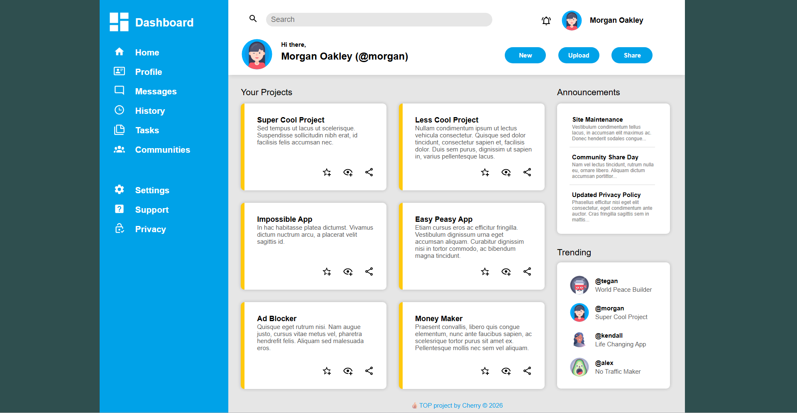
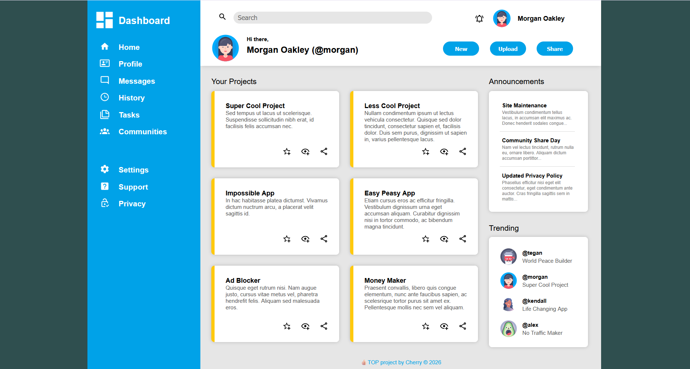

###
This is Project: Admin Dashboard from The Odin Project. 

Using HTML and CSS Grid. 

I tried to faithfully reproduce the <a href="https://raw.githubusercontent.com/TheOdinProject/curriculum/43cc6ab69fdfbef40d431a65677d2144668930ac/intermediate_html_css/grid/project_admin_dashboard/imgs/dashboard-project.png">design file</a> but man, CSS Grid is so hard, I have no more energy left to try my own design styles.

This is the outcome in my laptop, in Chrome (I have a 1280x429 browser screen):

And this is in Firefox:

Even using hacks, I couldn't fix and make them the same.

As this is not responsive (yet), this has a different and a messed up outcome on a different screen size, most especially mobile. 

This is the page -  https://webdevelopmentportfolio.github.io/Project-Admin-Dashboard/.

